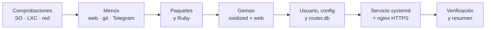

<div align="center">

```
   ____        _     ___               __
  / __ \_  __ (_)___/ (_)___  ___  ___/ /
 / / / / |/_// / __  / /_  / / _ \/ __  /
/ /_/ />  < / / /_/ / / / /_/  __/ /_/ /
\____/_/|_|/_/\__,_/_/ /___/\___/\__,_/
```

# Oxidized para Proxmox LXC

**Copias de seguridad automáticas de la configuración de tus routers, switches y firewalls,<br>instaladas en un LXC con un solo comando.**

[](LICENSE)


[](https://github.com/ytti/oxidized)

[Instalación](#-instalación-rápida) ·
[Opciones](#%EF%B8%8F-opciones-de-instalación) ·
[Inventario](#-añadir-equipos) ·
[Seguridad](#-seguridad) ·
[Mantenimiento](#-mantenimiento)

</div>

---

## ✨ Qué hace

Un único script, con el estilo de [community-scripts/ProxmoxVE](https://github.com/community-scripts/ProxmoxVE), que se ejecuta **dentro de un LXC que ya has creado** y deja [Oxidized](https://github.com/ytti/oxidized) funcionando como servicio. Durante la instalación te pregunta todo con menús.

| | |
|---|---|
| 🧩 **Autocontenido** | No depende de `build.func` ni de ningún fork: un solo fichero. |
| 🎛️ **Interactivo o desatendido** | Menús *whiptail*, o variables de entorno para automatizarlo. |
| 🔐 **Seguro por defecto** | Solo SSH, huellas verificadas, HTTPS, secretos fuera de la web y de Telegram. |
| 🌐 **Interfaz web a elegir** | HTTPS con usuario y contraseña (nginx), sin web, o HTTP directo. |
| 🗂️ **Historial en git** | Cada cambio de configuración es un commit, con push opcional a Gitea o GitHub. |
| 📣 **Avisos por Telegram** | Un mensaje cada vez que cambia la configuración de un equipo. |
| 🔁 **Mantenimiento integrado** | Vuelve a ejecutar el script para actualizar, hacer una copia de seguridad o desinstalar. |

## 📋 Requisitos

- Un **LXC** en Proxmox (privilegiado o no, ambos sirven) con:
  - 🟥 **Debian 13** · 🟧 **Ubuntu 24.04** · 🟧 **Ubuntu 26.04**
  - Acceso a Internet (paquetes y [rubygems.org](https://rubygems.org))
  - Recomendado: **1 vCPU, 1 GB de RAM y 4 GB de disco** (la instalación compila extensiones de Ruby)
- Que los equipos de red sean accesibles por **SSH** desde el LXC.

> [!NOTE]
> Probado en Debian 13 con Oxidized 0.37.0 y oxidized-web 0.18.1.

## 🚀 Instalación rápida

Dentro del LXC, como `root`:

```bash
bash -c "$(curl -fsSL https://raw.githubusercontent.com/Psycomy/oxidized-proxmox-lxc/v1.0.0/oxidized-install.sh)"
```

> [!TIP]
> El comando apunta a la etiqueta **`v1.0.0`**, no a `main`. Así sabes exactamente qué código ejecutas como root, aunque el repositorio cambie después.

Si prefieres revisarlo antes de ejecutarlo:

```bash
curl -fsSLO https://raw.githubusercontent.com/Psycomy/oxidized-proxmox-lxc/v1.0.0/oxidized-install.sh
less oxidized-install.sh
bash oxidized-install.sh
```

### Qué ocurre durante la instalación



Al terminar verás algo así:

```
  ✔️  Sistema actualizado
  ✔️  Dependencias instaladas
  ✔️  Ruby 3.3.8
  ✔️  Instalado Oxidized 0.37.0 (/usr/local/bin/oxidized)
  ✔️  Usuario oxidized y directorios creados
  ✔️  Configuración escrita en /etc/oxidized
  ✔️  Instalado oxidized-reload
  ✔️  Servicio oxidized creado (arrancará al añadir equipos)
  ✔️  nginx configurado con HTTPS (443) y redirección desde el 80
  ✔️  Configuración válida; Oxidized arrancará al añadir equipos

  ✔️  Oxidized 0.37.0 instalado correctamente
  💡  Web:            https://192.168.1.50  (usuario: admin, certificado autofirmado)
  💡  Inventario:     /etc/oxidized/router.db
```

## ⚙️ Opciones de instalación

El script pregunta lo siguiente. Si defines la variable de entorno correspondiente, se salta esa pregunta, lo que permite una **instalación desatendida**.

| Pregunta | Variable | Valores | Por defecto |
|---|---|---|---|
| Interfaz web | `OXI_WEB_MODE` | `nginx` · `none` · `direct` | — |
| Usuario de la web | `OXI_WEB_USER` | texto | `admin` |
| Contraseña de la web | `OXI_WEB_PASS` | texto | — |
| Almacenamiento | `OXI_GIT_MODE` | `local` · `remote` | — |
| Repositorio remoto | `OXI_GIT_REMOTE` | URL SSH | — |
| Avisos por Telegram | `OXI_TELEGRAM` | `yes` · `no` | — |
| Token del bot | `OXI_TG_TOKEN` | texto | — |
| Chat ID | `OXI_TG_CHAT` | texto | — |
| Intervalo entre copias | `OXI_INTERVAL` | segundos | `3600` |
| Versión de Oxidized | `OXI_VERSION` | p. ej. `0.37.0` | la última |
| Versión de oxidized-web | `OXI_WEB_VERSION` | p. ej. `0.18.1` | la última |
| Salida detallada | `VERBOSE` | `yes` | oculta |

<details>
<summary><b>Ejemplo de instalación desatendida</b></summary>

```bash
export OXI_WEB_MODE=nginx OXI_WEB_USER=admin OXI_WEB_PASS='CambiaEsto!'
export OXI_GIT_MODE=local OXI_TELEGRAM=no OXI_INTERVAL=3600
bash oxidized-install.sh
```

</details>

### 🌐 Modos de la interfaz web

| Modo | Acceso | Cuándo usarlo |
|---|---|---|
| **`nginx`** ⭐ | `https://IP` con usuario y contraseña | El recomendado. TLS con certificado autofirmado, el puerto 80 redirige a HTTPS. |
| **`none`** | Ninguno desde fuera | Solo quieres las copias. La API queda en `127.0.0.1` para `oxidized-reload`. |
| **`direct`** ⚠️ | `http://IP:8888` **sin autenticación** | Solo en redes totalmente aisladas. El script pide confirmación antes de usarlo. |

<details>
<summary><b>Usar tu propio certificado TLS</b></summary>

Sustituye estos dos ficheros y recarga nginx:

```bash
/etc/nginx/ssl/oxidized.crt   # certificado (con la cadena)
/etc/nginx/ssl/oxidized.key   # clave privada (permisos 600)
systemctl reload nginx
```

</details>

### 🗂️ Almacenamiento

- **`local`**: repositorio git en `/var/lib/oxidized/configs.git`, con el historial completo visible en la web.
- **`remote`**: lo mismo, más un **push automático** a un repositorio remoto tras cada cambio. El script genera una clave SSH y te la muestra para que la añadas como **Deploy Key con permiso de escritura**. La URL tiene que ser SSH, por ejemplo `git@gitea.local:red/oxidized-configs.git`.

### 📣 Telegram

Crea un bot con [@BotFather](https://t.me/BotFather), consigue el chat ID y el script envía un mensaje de prueba al terminar. Cada vez que cambie la configuración de un equipo recibirás:

```
🔄 Cambio de configuración detectado
Equipo: core-sw01
IP: 192.0.2.10
Modelo: IOS
Líneas: +3 / -2
Commit: 22fbfae3f1
```

> [!IMPORTANT]
> El aviso **no incluye el diff**: las configuraciones contienen secretos (hashes, comunidades SNMP, claves de VPN…) que no deben acabar en Telegram. El detalle está en la web.

## 📝 Añadir equipos

El inventario es `/etc/oxidized/router.db`: **un equipo por línea**, campos separados por `;`, con **credenciales propias para cada equipo**.

```text
# nombre;ip;modelo;usuario;contraseña;enable
core-sw01;192.0.2.10;ios;backup;S3cr3t;EnableS3cr3t
edge-rtr01;2001:db8::1;junos;backup;Otra:Clave;
mk-oficina;198.51.100.5;routeros;admin;MiClave;
```

| Campo | Descripción |
|---|---|
| `nombre` | Identificador único; es el que aparece en la web y en git. |
| `ip` | IPv4, IPv6 o nombre DNS. |
| `modelo` | `ios`, `nxos`, `junos`, `routeros`, `fortios`, `procurve`, `comware`, `eos`… ([lista completa](https://github.com/ytti/oxidized/blob/master/docs/Supported-OS-Types.md)) |
| `usuario` / `contraseña` | Acceso SSH a ese equipo. |
| `enable` | Contraseña de modo privilegiado; vacío si no hace falta (la línea termina en `;`). |

> [!NOTE]
> Se usa `;` como separador para admitir IPv6 y contraseñas con `:`. Por eso una contraseña **no puede contener `;`**.

Después de editar el fichero:

```bash
oxidized-reload
```

### 🔄 `oxidized-reload`

| Comando | Qué hace |
|---|---|
| `oxidized-reload` | Valida `router.db`, **registra la huella SSH** de los equipos nuevos y recarga el inventario sin reiniciar. Si Oxidized estaba parado, lo arranca. |
| `oxidized-reload --trust IP [PUERTO]` | Vuelve a registrar la huella SSH de un equipo, por ejemplo tras sustituirlo. |
| `oxidized-reload --forget IP [PUERTO]` | Borra la huella registrada de un equipo. |

```
$ oxidized-reload
Huella SSH registrada para mk-oficina (198.51.100.5):
    256 SHA256:pF3vwFAJB0zDv3iwz0daAKhyjhCVNCjAKBG1nIoNLJg 198.51.100.5 (ED25519)
Oxidized estaba parado; arrancándolo con 1 equipo(s)...
Oxidized en marcha.
```

> [!TIP]
> Compara la huella que muestra con la del propio equipo, por ejemplo conectándote tú por SSH desde otra máquina de confianza, para asegurarte de que es la buena.

> [!NOTE]
> Oxidized **no arranca con el inventario vacío**. El servicio queda en espera, sin errores ni reinicios, hasta que añades el primer equipo y ejecutas `oxidized-reload`.

## 🔐 Seguridad

El script se ha revisado para proteger, ante todo, **las credenciales de tus equipos**:

| Medida | Detalle |
|---|---|
| 🔒 **Solo SSH** | Sin recurrir a Telnet, que enviaría las contraseñas en claro si SSH fallase. |
| 🪪 **Huellas SSH verificadas** | `input.ssh.secure: true`. `oxidized-reload` registra la huella la primera vez y, si un equipo cambia de clave, la copia falla en lugar de entregar la contraseña a un impostor. |
| 🔐 **HTTPS** | nginx con TLS 1.2/1.3, redirección desde HTTP y cabeceras de seguridad. |
| 🔑 **Contraseña de la web en SHA-512** | Generada sin pasar la contraseña por la línea de comandos. |
| 🙈 **`enable` oculto en la web** | `hide_node_vars: [enable]`, para que no se vea en la ficha del equipo ni en la API. |
| 📵 **Telegram sin secretos** | Solo envía un resumen; el token del bot no aparece en la lista de procesos. |
| 👤 **Usuario sin privilegios** | Oxidized se ejecuta como `oxidized`, sin shell y con `NoNewPrivileges`. |
| 📁 **Permisos ajustados** | `router.db` 600, `telegram.env` 640, copias de seguridad y log de instalación 600. |

> [!WARNING]
> Las configuraciones guardadas en git **contienen secretos**, porque es una copia completa que sirve para restaurar. Protege el acceso al LXC y, si usas push remoto, a ese repositorio. Si prefieres eliminarlos de las copias, añade `remove_secret: true` en `vars:` (ver la [documentación de Oxidized](https://github.com/ytti/oxidized/blob/master/docs/Configuration.md#removing-secrets)).

## 🧰 Mantenimiento

Vuelve a ejecutar el script en el mismo LXC y aparecerá este menú:

| Opción | Qué hace |
|---|---|
| **Actualizar** | Hace una copia de seguridad y después actualiza el sistema y las gemas de Oxidized, conservando tu configuración. |
| **Copia de seguridad** | Guarda la configuración, el inventario, el repositorio git, nginx y TLS en `/root/oxidized-backup-FECHA.tar.gz`. |
| **Desinstalar** | Lo elimina todo, ofreciendo antes una copia de seguridad y la opción de conservar el repositorio git. |

## 📂 Dónde está cada cosa

```text
/etc/oxidized/
├── config               # configuración de Oxidized
├── router.db            # inventario de equipos (600)
└── telegram.env         # token y chat de Telegram (640)
/var/lib/oxidized/
├── configs.git/         # historial de configuraciones
└── .ssh/
    ├── known_hosts      # huellas SSH de los equipos (y del remoto git)
    └── id_rsa(.pub)     # clave para el push remoto
/etc/nginx/ssl/          # certificado TLS
/usr/local/bin/
├── oxidized-reload
└── oxidized-telegram-notify
/var/log/oxidized-install.log
```

## 🩺 Solución de problemas

<details>
<summary><b>Ver los logs</b></summary>

```bash
journalctl -u oxidized -f          # Oxidized en tiempo real
systemctl status oxidized
cat /var/log/oxidized-install.log  # instalación
VERBOSE=yes bash oxidized-install.sh   # instalación mostrando toda la salida
```

</details>

<details>
<summary><b>Un equipo falla por la huella SSH (host key)</b></summary>

Si has sustituido el equipo o regenerado su clave SSH, la huella ya no coincide. Comprueba que el cambio es legítimo y vuelve a registrarla:

```bash
oxidized-reload --trust 192.0.2.10
```

Para equipos con SSH en un puerto distinto del 22, indica el puerto: `oxidized-reload --trust 192.0.2.10 2222`.

</details>

<details>
<summary><b>Un equipo solo admite Telnet</b></summary>

Telnet está desactivado por defecto. Puedes activarlo para un modelo concreto en `/etc/oxidized/config` y reiniciar el servicio:

```yaml
models:
  procurve:
    input: telnet
```

Ten en cuenta que las credenciales de ese equipo viajarán en claro.

</details>

<details>
<summary><b>El servicio no arranca</b></summary>

- **Sin equipos en `router.db`:** es lo esperado. Añade uno y ejecuta `oxidized-reload`.
- **`invalid byte sequence in US-ASCII`:** falta el locale UTF-8 en el servicio. El script lo configura en el unit de systemd; revisa que no lo hayas sobrescrito.

</details>

<details>
<summary><b>Personalizar la configuración de Oxidized</b></summary>

Grupos, credenciales por modelo, puertos SSH, bastiones, algoritmos antiguos y otras opciones: consulta la [documentación oficial](https://github.com/ytti/oxidized/blob/master/docs/Configuration.md). Tras editar `/etc/oxidized/config`, ejecuta `systemctl restart oxidized`.

</details>

## 🙏 Créditos

- [**Oxidized**](https://github.com/ytti/oxidized) y [**oxidized-web**](https://github.com/ytti/oxidized-web), de ytti y su comunidad.
- Estilo inspirado en [**community-scripts/ProxmoxVE**](https://github.com/community-scripts/ProxmoxVE).

## 📄 Licencia

[MIT](LICENSE) © 2026 Psycomy
