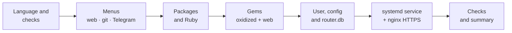

<div align="center">

**🇬🇧 English** · [🇪🇸 Español](README.es.md)

```
   ____        _     ___               __
  / __ \_  __ (_)___/ (_)___  ___  ___/ /
 / / / / |/_// / __  / /_  / / _ \/ __  /
/ /_/ />  < / / /_/ / / / /_/  __/ /_/ /
\____/_/|_|/_/\__,_/_/ /___/\___/\__,_/
```

# Oxidized for Proxmox LXC

**Automatic configuration backups for your routers, switches and firewalls,<br>installed in an LXC with a single command.**

[](LICENSE)


[](https://github.com/ytti/oxidized)

[Install](#-quick-install) ·
[Options](#%EF%B8%8F-installation-options) ·
[Inventory](#-adding-devices) ·
[Security](#-security) ·
[Maintenance](#-maintenance)

</div>

---

## ✨ What it does

A single script, in the style of [community-scripts/ProxmoxVE](https://github.com/community-scripts/ProxmoxVE), that runs **inside an LXC you have already created** and leaves [Oxidized](https://github.com/ytti/oxidized) running as a service. It asks everything through menus during the installation.

| Feature | Details |
|---|---|
| 🧩 **Self-contained** | No dependency on `build.func` or any fork: a single file. |
| 🌍 **English or Spanish** | Pick the language at start: messages, menus, generated files and notifications. |
| 🎛️ **Interactive or unattended** | *whiptail* menus, or environment variables to automate it. |
| 🔐 **Secure by default** | SSH only, verified fingerprints, HTTPS, secrets kept out of the web UI and Telegram. |
| 🌐 **Choice of web interface** | HTTPS with username and password (nginx), no web, or plain HTTP. |
| 🗂️ **Git history** | Every configuration change is a commit, with optional push to Gitea or GitHub. |
| 📣 **Telegram notifications** | A message every time a device configuration changes. |
| 🔁 **Built-in maintenance** | Run the script again to update, back up or uninstall. |

## 📋 Requirements

- A Proxmox **LXC** (privileged or unprivileged, both work) with:
  - 🟩 **Debian 13** (tested) · 🟨 **Ubuntu 24.04** (not tested yet) · 🟨 **Ubuntu 26.04** (not tested yet)
  - Internet access (packages and [rubygems.org](https://rubygems.org))
  - Recommended: **1 vCPU, 1 GB RAM and 4 GB disk** (the installation compiles Ruby extensions)
- Network devices reachable over **SSH** from the LXC.

> [!NOTE]
> Tested on Debian 13 with Oxidized 0.37.0 and oxidized-web 0.18.1. On Ubuntu 24.04 and 26.04 the script is ready (including the *universe* repository) but **has not been tested yet**.

## 🚀 Quick install

Inside the LXC, as `root`:

```bash
bash -c "$(curl -fsSL https://raw.githubusercontent.com/Psycomy/oxidized-proxmox-lxc/v1.1.1/oxidized-install.sh)"
```

> [!TIP]
> The command points to the **`v1.1.1`** tag, not `main`. That way you know exactly which code you run as root, even if the repository changes later.

If you prefer to review it before running it:

```bash
curl -fsSLO https://raw.githubusercontent.com/Psycomy/oxidized-proxmox-lxc/v1.1.1/oxidized-install.sh
less oxidized-install.sh
bash oxidized-install.sh
```

### What happens during the installation



When it finishes you will see something like:

```
  ✔️  System updated
  ✔️  Dependencies installed
  ✔️  Ruby 3.3.8
  ✔️  Installed Oxidized 0.37.0 (/usr/local/bin/oxidized)
  ✔️  User oxidized and directories created
  ✔️  Configuration written to /etc/oxidized
  ✔️  Installed oxidized-reload
  ✔️  oxidized service created (it will start once devices are added)
  ✔️  nginx configured with HTTPS (443) and redirect from port 80
  ✔️  Configuration is valid; Oxidized will start once devices are added

  ✔️  Oxidized 0.37.0 installed successfully
  💡  Web:                 https://192.168.1.50  (user: admin, self-signed certificate)
  💡  Inventory:           /etc/oxidized/router.db
```

## ⚙️ Installation options

The first question is the **language** (*English* / *Español*); it is remembered for later runs. Then the script asks the following. If you set the matching environment variable, that question is skipped, which allows an **unattended installation**.

| Question | Variable | Values | Default |
|---|---|---|---|
| Language | `OXI_LANG` | `en` · `es` | system language |
| Web interface | `OXI_WEB_MODE` | `nginx` · `none` · `direct` | — |
| Web username | `OXI_WEB_USER` | text | `admin` |
| Web password | `OXI_WEB_PASS` | text | — |
| Storage | `OXI_GIT_MODE` | `local` · `remote` | — |
| Remote repository | `OXI_GIT_REMOTE` | SSH URL | — |
| Telegram notifications | `OXI_TELEGRAM` | `yes` · `no` | — |
| Bot token | `OXI_TG_TOKEN` | text | — |
| Chat ID | `OXI_TG_CHAT` | text | — |
| Interval between backups | `OXI_INTERVAL` | seconds | `3600` |
| Oxidized version | `OXI_VERSION` | e.g. `0.37.0` | latest |
| oxidized-web version | `OXI_WEB_VERSION` | e.g. `0.18.1` | latest |
| Verbose output | `VERBOSE` | `yes` | hidden |

<details>
<summary><b>Unattended installation example</b></summary>

It also works without a terminal, for example from the Proxmox host with `pct exec <id> -- env OXI_LANG=en ... bash /root/oxidized-install.sh`.

```bash
export OXI_LANG=en OXI_WEB_MODE=nginx OXI_WEB_USER=admin OXI_WEB_PASS='ChangeMe!'
export OXI_GIT_MODE=local OXI_TELEGRAM=no OXI_INTERVAL=3600
bash oxidized-install.sh
```

</details>

### 🌐 Web interface modes

| Mode | Access | When to use it |
|---|---|---|
| **`nginx`** ⭐ | `https://IP` with username and password | Recommended. TLS with a self-signed certificate; port 80 redirects to HTTPS. |
| **`none`** | None from outside | You only want the backups. The API stays on `127.0.0.1` for `oxidized-reload`. |
| **`direct`** ⚠️ | `http://IP:8888` **without authentication** | Only on fully isolated networks. The script asks for confirmation first. In this mode `/nodes.json` also exposes enable passwords. |

<details>
<summary><b>Using your own TLS certificate</b></summary>

Replace these two files and reload nginx:

```bash
/etc/nginx/ssl/oxidized.crt   # certificate (with chain)
/etc/nginx/ssl/oxidized.key   # private key (mode 600)
systemctl reload nginx
```

</details>

### 🗂️ Storage

- **`local`**: git repository in `/var/lib/oxidized/configs.git`, with the full history visible in the web UI.
- **`remote`**: the same, plus an **automatic push** to a remote repository after each change. The script generates an SSH key and shows it so you can add it as a **Deploy Key with write access**. The URL must be SSH, for example `git@gitea.local:net/oxidized-configs.git`.

### 📣 Telegram

Create a bot with [@BotFather](https://t.me/BotFather), get the chat ID, and the script sends a test message when it finishes. Every time a device configuration changes you will receive:

```
🔄 Configuration change detected
Device: core-sw01
IP: 192.0.2.10
Model: IOS
Lines: +3 / -2
Commit: 22fbfae3f1
```

> [!IMPORTANT]
> The notification **does not include the diff**: configurations contain secrets (hashes, SNMP communities, VPN keys…) that must not end up in Telegram. The details are in the web UI.

## 📝 Adding devices

The inventory is `/etc/oxidized/router.db`: **one device per line**, fields separated by `;`, with **separate credentials for each device**.

```text
# name;ip;model;username;password;enable
core-sw01;192.0.2.10;ios;backup;S3cr3t;EnableS3cr3t
edge-rtr01;2001:db8::1;junos;backup;Another:Pass;
mk-office;198.51.100.5;routeros;admin;MyPass;
```

| Field | Description |
|---|---|
| `name` | Unique identifier; shown in the web UI and in git. |
| `ip` | IPv4, IPv6 or DNS name. |
| `model` | `ios`, `nxos`, `junos`, `routeros`, `fortios`, `procurve`, `comware`, `eos`… ([full list](https://github.com/ytti/oxidized/blob/master/docs/Supported-OS-Types.md)) |
| `username` / `password` | SSH access to that device. |
| `enable` | Privileged-mode password; empty if not needed (the line ends with `;`). |

> [!NOTE]
> `;` is used as separator so IPv6 addresses and passwords containing `:` are allowed. Because of that, a password **cannot contain `;`**.

After editing the file:

```bash
oxidized-reload
```

### 🔄 `oxidized-reload`

| Command | What it does |
|---|---|
| `oxidized-reload` | Validates `router.db`, **records the SSH fingerprint** of new devices and reloads the inventory without restarting. If Oxidized was stopped, it starts it; if no devices are left, it stops it. |
| `oxidized-reload --trust IP [PORT]` | Records a device's SSH fingerprint again, for example after replacing it. |
| `oxidized-reload --forget IP [PORT]` | Removes a device's recorded fingerprint. |

```
$ oxidized-reload
SSH fingerprint recorded for mk-office (198.51.100.5):
    256 SHA256:pF3vwFAJB0zDv3iwz0daAKhyjhCVNCjAKBG1nIoNLJg 198.51.100.5 (ED25519)
Oxidized was stopped; starting it with 1 device(s)...
Oxidized is running.
```

> [!TIP]
> Compare the fingerprint shown with the device's own, for example by connecting over SSH yourself from another trusted machine, to make sure it is the right one.

> [!NOTE]
> Oxidized **does not start with an empty inventory**. The service stays on hold, with no errors or restarts, until you add the first device and run `oxidized-reload`.

## 🔐 Security

The script has been reviewed to protect, above all, **your devices' credentials**:

| Measure | Details |
|---|---|
| 🔒 **SSH only** | No fallback to Telnet, which would send passwords in clear text if SSH failed. |
| 🪪 **Verified SSH fingerprints** | `input.ssh.secure: true`. `oxidized-reload` records the fingerprint the first time; if a device's key changes, the backup fails instead of handing the password to an impostor. |
| 🔐 **HTTPS** | nginx with TLS 1.2/1.3, redirect from HTTP and security headers. |
| 🔑 **SHA-512 web password** | Generated without passing the password on the command line. |
| 🙈 **`enable` hidden in the web UI** | `hide_node_vars: [enable]`, so it is not shown on the device page or in the API. |
| 🚫 **JSON node list blocked** | oxidized-web 0.18 ignores `hide_node_vars` in `/nodes.json`; nginx blocks those endpoints (the web UI does not use them). |
| 📵 **Telegram without secrets** | Sends only a summary; the bot token does not appear in the process list. |
| 👤 **Unprivileged user** | Oxidized runs as `oxidized`, without a shell and with `NoNewPrivileges`. |
| 📁 **Tight permissions** | `router.db` 600, `telegram.env` 640, backups and installation log 600. |

> [!WARNING]
> Configurations stored in git **contain secrets**, because they are full backups you can restore from. Protect access to the LXC and, if you use remote push, to that repository. If you prefer to strip them from the backups, add `remove_secret: true` under `vars:` (see the [Oxidized documentation](https://github.com/ytti/oxidized/blob/master/docs/Configuration.md#removing-secrets)).

## 🧰 Maintenance

Run the script again in the same LXC and this menu appears:

| Option | What it does |
|---|---|
| **Update** | Makes a backup, then updates the system and the Oxidized gems and regenerates the files managed by the installer (nginx site, `oxidized-reload`, Telegram hook), keeping your configuration, inventory, passwords and certificates. |
| **Backup** | Saves the configuration, inventory, git repository, nginx and TLS to `/root/oxidized-backup-DATE.tar.gz`. |
| **Uninstall** | Removes everything, offering a backup first and the option to keep the git repository. |

## 📂 Where everything lives

```text
/etc/oxidized/
├── config               # Oxidized configuration
├── router.db            # device inventory (600)
├── telegram.env         # Telegram token and chat (640)
└── installer.lang       # language chosen at installation
/var/lib/oxidized/
├── configs.git/         # configuration history
└── .ssh/
    ├── known_hosts      # SSH fingerprints of devices (and of the git remote)
    └── id_rsa(.pub)     # key for remote push
/etc/nginx/ssl/          # TLS certificate
/usr/local/bin/
├── oxidized-reload
└── oxidized-telegram-notify
/var/log/oxidized-install.log
```

## 🩺 Troubleshooting

<details>
<summary><b>Viewing the logs</b></summary>

```bash
journalctl -u oxidized -f          # Oxidized in real time
systemctl status oxidized
cat /var/log/oxidized-install.log  # installation
VERBOSE=yes bash oxidized-install.sh   # installation showing all output
```

</details>

<details>
<summary><b>A device fails because of its SSH fingerprint (host key)</b></summary>

If you replaced the device or regenerated its SSH key, the fingerprint no longer matches. Check that the change is legitimate and record it again:

```bash
oxidized-reload --trust 192.0.2.10
```

For devices with SSH on a port other than 22, give the port: `oxidized-reload --trust 192.0.2.10 2222`.

</details>

<details>
<summary><b>A device only supports Telnet</b></summary>

Telnet is disabled by default. You can enable it for a specific model in `/etc/oxidized/config` and restart the service:

```yaml
models:
  procurve:
    input: telnet
```

Keep in mind that this device's credentials will travel in clear text.

</details>

<details>
<summary><b>The service does not start</b></summary>

- **No devices in `router.db`:** this is expected. Add one and run `oxidized-reload`.
- **`invalid byte sequence in US-ASCII`:** the service is missing the UTF-8 locale. The script sets it in the systemd unit; check that you have not overwritten it.

</details>

<details>
<summary><b>Customising the Oxidized configuration</b></summary>

Groups, per-model credentials, SSH ports, jump hosts, legacy algorithms and other options: see the [official documentation](https://github.com/ytti/oxidized/blob/master/docs/Configuration.md). After editing `/etc/oxidized/config`, run `systemctl restart oxidized`.

</details>

## 🙏 Credits

- [**Oxidized**](https://github.com/ytti/oxidized) and [**oxidized-web**](https://github.com/ytti/oxidized-web), by ytti and the community.
- Style inspired by [**community-scripts/ProxmoxVE**](https://github.com/community-scripts/ProxmoxVE).

## 📄 License

[MIT](LICENSE) © 2026 Psycomy
